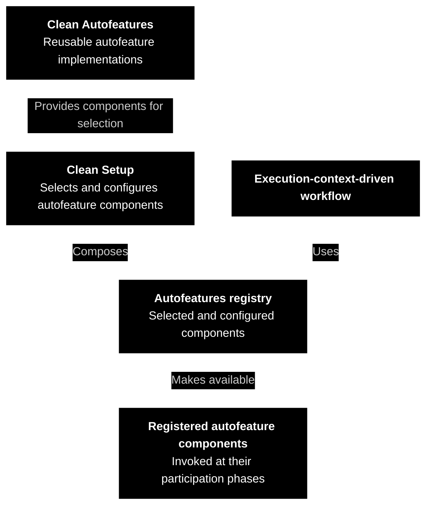
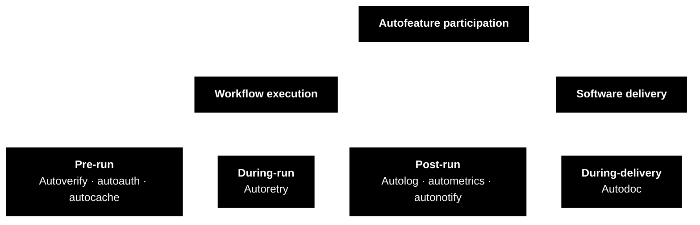
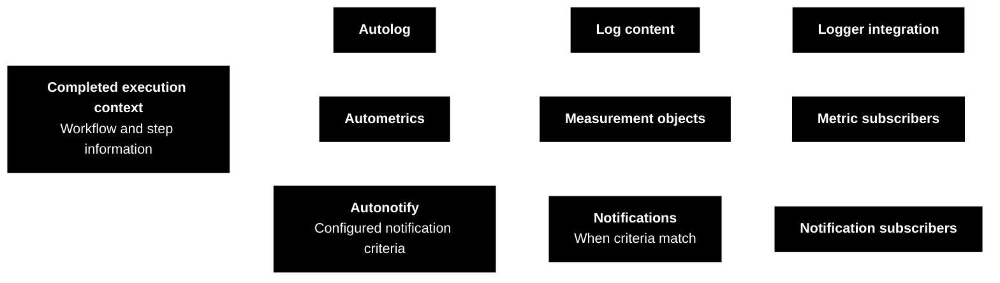

CAE Concept

---

 

### Clean Autofeatures

An application repeatedly needs to check requests, decide whether callers have access, record execution results, and report operational problems. Implementing these concerns separately in every workflow creates repeated work and inconsistent behavior.

**Autofeatures** are reusable components that apply these recurring behaviors using application declarations, execution information, and configured integrations. They can participate in [execution-context](https://github.com/clean-arch-enablers-project/clean-execution-context/blob/feature/hello-world/concept/README.md)-driven workflows, including [use cases](https://github.com/clean-arch-enablers-project/clean-use-cases/blob/feature/hello-world/concept/README.md): workflows performing [application capabilities](https://github.com/clean-arch-enablers-project/clean-use-cases/blob/feature/hello-world/concept/README.md). The composition of autofeature components supplies the selected checks and operational behavior around the workflow's business logic.

For example, a ***View Product*** capability may validate its input, check the caller's permissions, reuse a cached result, and publish execution information without implementing each concern inside its business logic.

 

#### Components and Composition

**Clean Autofeatures** provides the autofeature component implementations. For example, autolog creates log content from an [execution context](https://github.com/clean-arch-enablers-project/clean-execution-context/blob/feature/hello-world/concept/README.md), autometrics creates measurement objects from that context, and autonotify creates notifications from the recorded outcomes and its notification criteria. Output integrations can then write logs, store measurements, or deliver notifications.

[**Clean Setup**](https://github.com/clean-arch-enablers-project/clean-setup/blob/feature/hello-world/concept/README.md) is a separate concept responsible for application assembly. It selects and configures autofeature components provided by Clean Autofeatures and composes the **autofeatures registry**: the collection of configured autofeature components available to a workflow. Other workflow concepts, such as [**Clean Use Cases**](https://github.com/clean-arch-enablers-project/clean-use-cases/blob/feature/hello-world/concept/README.md), depend on [Clean Setup](https://github.com/clean-arch-enablers-project/clean-setup/blob/feature/hello-world/concept/README.md) to obtain the autofeatures registry and invoke its registered autofeature components at the appropriate lifecycle points.

Each autofeature component has a defined responsibility; [Clean Setup](https://github.com/clean-arch-enablers-project/clean-setup/blob/feature/hello-world/concept/README.md) determines which autofeature components participate in a particular workflow.

 

#### Four Participation Phases

Autofeature components are organized by when they participate in workflow execution or software delivery:

| Kind | Autofeatures | Participation |
| --- | --- | --- |
| **Pre-run** | Autoverify, autoauth, autocache | Verify input, evaluate access, and look for a reusable result before running the business operation. |
| **During-run** | Autoretry | Apply declared [retry policies](https://github.com/clean-arch-enablers-project/clean-trier/blob/feature/hello-world/concept/README.md) while a [use case](https://github.com/clean-arch-enablers-project/clean-use-cases/blob/feature/hello-world/concept/README.md) or [port](https://github.com/clean-arch-enablers-project/clean-use-cases/blob/feature/hello-world/concept/README.md) operation is being executed. |
| **Post-run** | Autolog, autometrics, autonotify | Consume completed execution information to produce log content, measurements, and operational notifications. |
| **During-delivery** | Autodoc | Inspect application declarations and produce documentation as part of building and delivering the software. |

During-delivery refers to building and delivering the application. Pre-run, during-run, and post-run autofeatures participate in individual workflow executions.

These phases identify where the autofeature components belong in the workflow or software delivery lifecycle. [Clean Setup](https://github.com/clean-arch-enablers-project/clean-setup/blob/feature/hello-world/concept/README.md) determines which autofeature components are registered for each phase. A pre-run cache hit can supply the result without executing the business operation, while applicable validation and authorization still precede reuse.

 

#### Declarations, Execution Information, and Integrations

Autofeature components use application declarations and execution information together with application-supplied integrations:

- **Declarations:** requirements and characteristics attached to application models and capabilities, such as input constraints, required permissions, or caching settings.
- **Execution information:** the current [actor](https://github.com/clean-arch-enablers-project/clean-ontology/blob/feature/hello-world/concept/README.md), [correlation identifier](https://github.com/clean-arch-enablers-project/clean-execution-context/blob/feature/hello-world/concept/README.md), timing, outcome, input, output, and recorded operations. The [execution context](https://github.com/clean-arch-enablers-project/clean-execution-context/blob/feature/hello-world/concept/README.md) carries this information.
- **Integrations:** application-supplied components that retrieve [roles](https://github.com/clean-arch-enablers-project/clean-ontology/blob/feature/hello-world/concept/README.md), write logs, receive metrics, or deliver notifications.

[Clean Ontology](https://github.com/clean-arch-enablers-project/clean-ontology/blob/feature/hello-world/concept/README.md) explains the meaning of [actors](https://github.com/clean-arch-enablers-project/clean-ontology/blob/feature/hello-world/concept/README.md), [actions](https://github.com/clean-arch-enablers-project/clean-ontology/blob/feature/hello-world/concept/README.md), [resources](https://github.com/clean-arch-enablers-project/clean-ontology/blob/feature/hello-world/concept/README.md), and [owners](https://github.com/clean-arch-enablers-project/clean-ontology/blob/feature/hello-world/concept/README.md). Autofeature components interpret input constraints, authorization requirements, and other declarations relevant to their responsibilities. Autofeature configuration identifies the integrations each component uses and how those integrations run.

 

#### Autoverify

**Autoverify** checks declared input requirements before the protected workflow executes. Autoverify covers required values, nonempty strings or collections, nonblank text, and validation of nested input objects or their collections.

The input constraints checked by autoverify express different requirements. A nonblank requirement rejects empty or whitespace-only text; a required-value constraint separately rejects an absent value. Applications combine required-value and nonblank declarations where both input requirements apply.

For example, ***Create Product*** can require a supplied name containing meaningful text. Additional application-defined validation handles rules that the standard input-validation declarations cannot express.

A validation failure prevents the workflow from proceeding and is recorded as a failed execution step. Invalid requests produce [mapped input failures](https://github.com/clean-arch-enablers-project/clean-mapped-exceptions/blob/feature/hello-world/concept/README.md); unsupported input-validation declarations or failures in validation machinery indicate implementation or validation-configuration problems.

 

#### Autoauth

**Autoauth** determines whether the current [actor](https://github.com/clean-arch-enablers-project/clean-ontology/blob/feature/hello-world/concept/README.md) may execute a protected capability. An **[actor](https://github.com/clean-arch-enablers-project/clean-ontology/blob/feature/hello-world/concept/README.md)** is the user or automated system requesting work. Authentication establishes that identity; authorization evaluates its permission to act. Autoauth consumes [actor](https://github.com/clean-arch-enablers-project/clean-ontology/blob/feature/hello-world/concept/README.md) information rather than performing sign-in itself.

A protected capability declares the authorization strategy that autoauth evaluates: scope-based requirements or role-based access control.

 

##### Scope-Based Authorization

A **scope** is a permission value carried by the [actor](https://github.com/clean-arch-enablers-project/clean-ontology/blob/feature/hello-world/concept/README.md). The [use case](https://github.com/clean-arch-enablers-project/clean-use-cases/blob/feature/hello-world/concept/README.md) declares a scope expression, which is evaluated against those values. Scope expressions support AND, OR, NOT, and parentheses.

For example, ***Update Product*** might require ***Product Editing*** or ***Catalog Administration***. Both edge capabilities intended for external [actors](https://github.com/clean-arch-enablers-project/clean-ontology/blob/feature/hello-world/concept/README.md) and internal capabilities implementing system mechanics can declare scope requirements.

An unsatisfied scope expression prevents the protected capability from executing. A protected invocation also needs [actor](https://github.com/clean-arch-enablers-project/clean-ontology/blob/feature/hello-world/concept/README.md) information; missing [actor](https://github.com/clean-arch-enablers-project/clean-ontology/blob/feature/hello-world/concept/README.md) data is an execution setup problem.

 

##### Role-Based Access Control

**Role-based access control (RBAC)** connects an [actor](https://github.com/clean-arch-enablers-project/clean-ontology/blob/feature/hello-world/concept/README.md)'s assigned [roles](https://github.com/clean-arch-enablers-project/clean-ontology/blob/feature/hello-world/concept/README.md) to the requested [action](https://github.com/clean-arch-enablers-project/clean-ontology/blob/feature/hello-world/concept/README.md) and the [owner](https://github.com/clean-arch-enablers-project/clean-ontology/blob/feature/hello-world/concept/README.md) of the target [resource](https://github.com/clean-arch-enablers-project/clean-ontology/blob/feature/hello-world/concept/README.md).

An edge [use case](https://github.com/clean-arch-enablers-project/clean-use-cases/blob/feature/hello-world/concept/README.md) declares an **[action identifier](https://github.com/clean-arch-enablers-project/clean-ontology/blob/feature/hello-world/concept/README.md)**. A **[policy](https://github.com/clean-arch-enablers-project/clean-ontology/blob/feature/hello-world/concept/README.md)** contains statements referring to [actions](https://github.com/clean-arch-enablers-project/clean-ontology/blob/feature/hello-world/concept/README.md); a **[role](https://github.com/clean-arch-enablers-project/clean-ontology/blob/feature/hello-world/concept/README.md)** associates a [policy](https://github.com/clean-arch-enablers-project/clean-ontology/blob/feature/hello-world/concept/README.md) with an [owner](https://github.com/clean-arch-enablers-project/clean-ontology/blob/feature/hello-world/concept/README.md). The configured [role](https://github.com/clean-arch-enablers-project/clean-ontology/blob/feature/hello-world/concept/README.md) retriever supplies the [actor](https://github.com/clean-arch-enablers-project/clean-ontology/blob/feature/hello-world/concept/README.md)'s [roles](https://github.com/clean-arch-enablers-project/clean-ontology/blob/feature/hello-world/concept/README.md) for the requested [action](https://github.com/clean-arch-enablers-project/clean-ontology/blob/feature/hello-world/concept/README.md), using either a default retriever or an action-specific one.

Authorization requires an allowing statement for the requested [action](https://github.com/clean-arch-enablers-project/clean-ontology/blob/feature/hello-world/concept/README.md) and a matching [resource owner](https://github.com/clean-arch-enablers-project/clean-ontology/blob/feature/hello-world/concept/README.md) on an allowing [role](https://github.com/clean-arch-enablers-project/clean-ontology/blob/feature/hello-world/concept/README.md). The request can supply [owner identifiers](https://github.com/clean-arch-enablers-project/clean-ontology/blob/feature/hello-world/concept/README.md) directly. Otherwise, it supplies a [resource identifier](https://github.com/clean-arch-enablers-project/clean-ontology/blob/feature/hello-world/concept/README.md) and an application-provided ownership retriever determines the [owner](https://github.com/clean-arch-enablers-project/clean-ontology/blob/feature/hello-world/concept/README.md).

For example, an assignment allowing ***Edit Document*** for ***Workspace A*** does not grant that [action](https://github.com/clean-arch-enablers-project/clean-ontology/blob/feature/hello-world/concept/README.md) on documents belonging to ***Workspace B***.

Both the permitted [action](https://github.com/clean-arch-enablers-project/clean-ontology/blob/feature/hello-world/concept/README.md) and the [resource ownership](https://github.com/clean-arch-enablers-project/clean-ontology/blob/feature/hello-world/concept/README.md) matter: the assigned [role](https://github.com/clean-arch-enablers-project/clean-ontology/blob/feature/hello-world/concept/README.md) must cover the [action](https://github.com/clean-arch-enablers-project/clean-ontology/blob/feature/hello-world/concept/README.md) for the [owner](https://github.com/clean-arch-enablers-project/clean-ontology/blob/feature/hello-world/concept/README.md) involved in the request.

 

#### Autoretry

**Autoretry** applies [retry policies](https://github.com/clean-arch-enablers-project/clean-trier/blob/feature/hello-world/concept/README.md) declared on [use cases](https://github.com/clean-arch-enablers-project/clean-use-cases/blob/feature/hello-world/concept/README.md) and [ports](https://github.com/clean-arch-enablers-project/clean-use-cases/blob/feature/hello-world/concept/README.md). A **[port](https://github.com/clean-arch-enablers-project/clean-use-cases/blob/feature/hello-world/concept/README.md)** is a contract for an operation a workflow needs from a dependency, such as retrieving a record or calling an external service. A retry executes the same operation again after an eligible failure.

Retry declarations specify which failures permit retry, the maximum number of additional attempts, and the delay between attempts. Delays can increase according to a configured [policy](https://github.com/clean-arch-enablers-project/clean-ontology/blob/feature/hello-world/concept/README.md), such as [exponential backoff](https://github.com/clean-arch-enablers-project/clean-trier/blob/feature/hello-world/concept/README.md). Three additional attempts allow up to four executions, including the initial attempt.

For example, a ***Retrieve Product Availability*** [port](https://github.com/clean-arch-enablers-project/clean-use-cases/blob/feature/hello-world/concept/README.md) can declare retries for temporary service failures. A workflow calling that [port](https://github.com/clean-arch-enablers-project/clean-use-cases/blob/feature/hello-world/concept/README.md) uses its normal contract; autoretry applies the declared retry behavior without requiring the workflow to construct a retry loop. A [use case](https://github.com/clean-arch-enablers-project/clean-use-cases/blob/feature/hello-world/concept/README.md) can likewise declare a [policy](https://github.com/clean-arch-enablers-project/clean-ontology/blob/feature/hello-world/concept/README.md) for retrying its own execution.

Under the hood, autoretry delegates retry execution to [Clean Trier](https://github.com/clean-arch-enablers-project/clean-trier/blob/feature/hello-world/concept/README.md). [Clean Trier](https://github.com/clean-arch-enablers-project/clean-trier/blob/feature/hello-world/concept/README.md) provides the execution mechanism; autoretry connects it to declarations on [application capabilities](https://github.com/clean-arch-enablers-project/clean-use-cases/blob/feature/hello-world/concept/README.md) and [dependency operations](https://github.com/clean-arch-enablers-project/clean-use-cases/blob/feature/hello-world/concept/README.md). From the [use-case](https://github.com/clean-arch-enablers-project/clean-use-cases/blob/feature/hello-world/concept/README.md) and workflow perspective, retry configuration remains declarative.

Retry scope matters: retrying a [port](https://github.com/clean-arch-enablers-project/clean-use-cases/blob/feature/hello-world/concept/README.md) repeats that dependency operation, while retrying a [use case](https://github.com/clean-arch-enablers-project/clean-use-cases/blob/feature/hello-world/concept/README.md) can repeat the entire workflow, including earlier side effects. Operations must be safe to repeat under their declared [policies](https://github.com/clean-arch-enablers-project/clean-ontology/blob/feature/hello-world/concept/README.md). When both levels have retries, the [port](https://github.com/clean-arch-enablers-project/clean-use-cases/blob/feature/hello-world/concept/README.md) and [use-case](https://github.com/clean-arch-enablers-project/clean-use-cases/blob/feature/hello-world/concept/README.md) [retry policies](https://github.com/clean-arch-enablers-project/clean-trier/blob/feature/hello-world/concept/README.md) must account for their combined number of attempts.

[Retry exhaustion](https://github.com/clean-arch-enablers-project/clean-trier/blob/feature/hello-world/concept/README.md) means the [retry policy](https://github.com/clean-arch-enablers-project/clean-trier/blob/feature/hello-world/concept/README.md) permits no further attempts. [Clean Trier](https://github.com/clean-arch-enablers-project/clean-trier/blob/feature/hello-world/concept/README.md) provides the underlying exhaustion handling, while workflow configuration determines how that outcome is reported or handled. Retry declarations do not by themselves supply a [fallback](https://github.com/clean-arch-enablers-project/clean-trier/blob/feature/hello-world/concept/README.md) or guarantee recovery.

 

#### Autocache

**Autocache** reuses previously produced results so suitable requests can avoid repeating the workflow's business logic. A cache key identifies requests that may share a result.

Applicable input verification and authorization precede cache lookup. On a cache hit, the stored result is returned. On a miss, the workflow produces a result and stores it for reuse.

The application declares how the cache key is obtained, such as from a designated input property or a key-producing operation. Cache keys must distinguish all information relevant to safe result reuse, including ownership or caller-specific differences where applicable.

Autocache delegates cache lookup and result storage to a registered **cache-storage client**. That integration can keep results in local memory or use a remote cache service. For example, an application can register a ***Redis-backed cache client*** or another custom cache-storage client through [Clean Setup](https://github.com/clean-arch-enablers-project/clean-setup/blob/feature/hello-world/concept/README.md). The workflow continues to use declarative caching regardless of where the cached results are stored.

Cache configuration defines result lifetime, capacity, and removal behavior according to the selected cache-storage client's capabilities. Removal strategies can include **least recently used (LRU)** and **least frequently used (LFU)**. The selected cache configuration must suit the freshness requirements of the result and the work being skipped.

 

#### Autolog

**Autolog** creates log content from a completed [execution context](https://github.com/clean-arch-enablers-project/clean-execution-context/blob/feature/hello-world/concept/README.md). It describes the workflow's subject, [correlation identifier](https://github.com/clean-arch-enablers-project/clean-execution-context/blob/feature/hello-world/concept/README.md), duration, outcome, and [recorded steps](https://github.com/clean-arch-enablers-project/clean-execution-context/blob/feature/hello-world/concept/README.md). A logger integration writes that content to the selected destination.

The application supplies the logger integration. Autolog configuration selects simple text or structured output, whether workflow and step input/output are included, and whether failure stack traces are recorded and how many lines are included.

Input/output inclusion and sensitive-field masking are explicit configuration choices. These logging settings determine what recorded execution data becomes part of the published log content.

 

#### Autometrics

**Autometrics** creates measurements from a completed workflow and its [recorded steps](https://github.com/clean-arch-enablers-project/clean-execution-context/blob/feature/hello-world/concept/README.md). Each measurement includes the subject, [correlation identifier](https://github.com/clean-arch-enablers-project/clean-execution-context/blob/feature/hello-world/concept/README.md), start and end times, duration, outcome, exception when present, and [execution direction](https://github.com/clean-arch-enablers-project/clean-execution-context/blob/feature/hello-world/concept/README.md). Step measurements also identify their parent execution.

Autometrics excludes execution-context input and output data from generated measurements by default. An explicit declaration can enable inclusion of the recorded input, output, or both. Recording those values in the [execution context](https://github.com/clean-arch-enablers-project/clean-execution-context/blob/feature/hello-world/concept/README.md) alone does not enable their inclusion in metrics.

A **subscriber** is an integration registered to receive these measurements. Applications can supply multiple subscribers, either directly or through [lazy initialization](https://github.com/clean-arch-enablers-project/clean-initializers/blob/feature/hello-world/concept/README.md), to forward records to their chosen monitoring systems.

For example, measurements for ***View Product*** can support reports about execution duration and failure rates. Autometrics produces and distributes the individual records; subscribers and monitoring systems perform storage, aggregation, and visualization.

 

#### Autonotify

**Autonotify** examines completed workflows and steps for configured conditions that deserve attention. Conditions include execution time exceeding a threshold and selected exception types or [mapped failure categories](https://github.com/clean-arch-enablers-project/clean-mapped-exceptions/blob/feature/hello-world/concept/README.md). Handling additional unexpected exceptions can also be enabled.

A notification carries its subject, [correlation identifier](https://github.com/clean-arch-enablers-project/clean-execution-context/blob/feature/hello-world/concept/README.md), applicable reasons, and exception when present. One execution can produce notifications for both the workflow and individual steps; a recovered step failure can still be relevant even when the workflow succeeds.

Registered autonotify subscribers receive operational notifications and implement delivery to the application's chosen destinations. Notification subscribers can be supplied directly or [initialized lazily](https://github.com/clean-arch-enablers-project/clean-initializers/blob/feature/hello-world/concept/README.md).

These notifications report operational conditions. Business events such as ***Product Created*** instead communicate domain changes between workflows. Notification criteria and subscribers define which operational conditions are reported and where they go.

 

#### Autodoc

**Autodoc** inspects application declarations and structures to produce machine-readable documentation. Autodoc describes the application itself rather than one request's execution, which is the focus of pre-run, during-run, and post-run autofeatures.

Autodoc output covers [business entity representations](https://github.com/clean-arch-enablers-project/clean-ontology/blob/feature/hello-world/concept/README.md), [use cases](https://github.com/clean-arch-enablers-project/clean-use-cases/blob/feature/hello-world/concept/README.md), and additional subjects explicitly selected for inspection. It describes [canonical names](https://github.com/clean-arch-enablers-project/clean-ontology/blob/feature/hello-world/concept/README.md) and [ontological functions](https://github.com/clean-arch-enablers-project/clean-ontology/blob/feature/hello-world/concept/README.md), properties, behaviors, [input/output contracts](https://github.com/clean-arch-enablers-project/clean-use-cases/blob/feature/hello-world/concept/README.md) and constraints, capability boundaries, authorization declarations, caching settings, developer notes, and available source code.

Generated documentation is available as machine-readable artifacts that can accompany the delivered application. Documentation tools and other consumers can inspect those artifacts to discover models and capabilities without executing their business logic.

For example, permission tooling can read documented [action identifiers](https://github.com/clean-arch-enablers-project/clean-ontology/blob/feature/hello-world/concept/README.md), [affected owner types](https://github.com/clean-arch-enablers-project/clean-ontology/blob/feature/hello-world/concept/README.md), and [operation classifications](https://github.com/clean-arch-enablers-project/clean-ontology/blob/feature/hello-world/concept/README.md) to register [actions](https://github.com/clean-arch-enablers-project/clean-ontology/blob/feature/hello-world/concept/README.md) and maintain standard access [policies](https://github.com/clean-arch-enablers-project/clean-ontology/blob/feature/hello-world/concept/README.md). That provisioning is performed by the consuming integration; generating documentation alone does not create [roles](https://github.com/clean-arch-enablers-project/clean-ontology/blob/feature/hello-world/concept/README.md) or grant permissions.

 

#### Lifecycle Integration

Workflows invoke the autofeature components composed through [Clean Setup](https://github.com/clean-arch-enablers-project/clean-setup/blob/feature/hello-world/concept/README.md) according to their participation phases. Pre-run checks happen before protected work or cached-result reuse; during-run behavior applies at the configured execution boundary; post-run autofeature components consume the recorded outcome. During-delivery autofeature components participate in the software delivery process separately from runtime execution.

[Clean Setup](https://github.com/clean-arch-enablers-project/clean-setup/blob/feature/hello-world/concept/README.md) defines autofeature component ordering, synchronous or asynchronous execution, and autofeature failure handling. These choices determine whether an operational integration can delay workflow completion and how a failure in one autofeature component affects the remaining registered autofeatures.

For autoretry, the workflow composition also defines the retry boundary: which work is repeated, how attempts are recorded, and when post-run autofeature components consume the final outcome. A [port](https://github.com/clean-arch-enablers-project/clean-use-cases/blob/feature/hello-world/concept/README.md) retry repeats the dependency operation; a [use-case](https://github.com/clean-arch-enablers-project/clean-use-cases/blob/feature/hello-world/concept/README.md) retry can repeat a broader workflow.

 

#### Shared Behavior from Explicit Information

Autofeatures use declared requirements to verify inputs, authorize work, retry eligible operations, reuse results, and turn execution information into logs, measurements, and notifications. Autodoc makes application declarations available to readers and tooling beyond an individual execution.

Together, these autofeature components reduce repeated operational code while keeping business behavior, metadata, and external integrations explicit. Autofeature behavior follows the application declarations, recorded execution information, and autofeature configuration supplied through its setup.

 
 

---

clean software, made easy.

